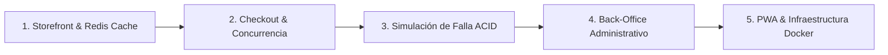

# GUÍA DE DEFENSA Y EVALUACIÓN DEL PROYECTO — MultiCatálogo
> **Documento maestro para la presentación ante el docente / evaluador.**
> Diseñado para responder con precisión quirúrgica a las rúbricas de la Unidad 1 (Frontend SPA) y Unidad 2 (Backend Transaccional en Entornos de Alta Concurrencia).

---

## 1. FICHA TÉCNICA Y CREDENCIALES DE ACCESO

### Credenciales de Demostración:
| Rol | Correo Electrónico | Contraseña | Vistas y Permisos Destacados |
|---|---|---|---|
| **👑 Administrador** | `admin@upse.edu.ec` | `123456` | Acceso total: Dashboard KPIs, Catálogo CRUD, Control de Pedidos y Liquidaciones MLM. |
| **🛍️ Cliente / Distribuidor** | `cliente@upse.edu.ec` | `123456` | Tienda, Catálogo, Carrito, Mis Pedidos, Mi Red MLM y Enlace de Referido propio. |

> [!TIP]
> En la pantalla de Login (`/login`), las cuentas de prueba son **botones interactivos**. Al hacer clic sobre cualquiera de ellas, los campos se autocompletan al instante.

### Puertos y Servicios:
- **Frontend SPA:** `http://localhost:5173` (React 19 + Tailwind CSS v4 + Vite)
- **Backend API:** `http://localhost:3000` (Go 1.27 + Fiber v2)
- **PostgreSQL 16:** `localhost:5434` (Base de datos relacional transaccional)
- **Redis Alpine:** `localhost:6379` (Motor de caché en memoria)
- **API Gateway (Producción):** `http://localhost:80` (Nginx Reverse Proxy con Rate Limiting)

---

## 2. GUIÓN DE DEMOSTRACIÓN DIDÁCTICA (10 / 10 EN 5 MINUTOS)

Sigue este orden exacto durante la sustentación para cubrir todos los temas de la planificación docente:



---

### PASO 1 · Interfaz React 19 y Patrón Cache-Aside (Redis)
*(Cumple: Unidad 1 completa + Unidad 2 Tema 3)*

1. Inicia sesión como **Cliente** (`cliente@upse.edu.ec`).
2. Navega a **Catálogo** (`/catalogo`):
   - Muestra la búsqueda reactiva y los filtros de categoría con `useMemo`.
   - **Punto Clave:** Señala la insignia superior en vivo: `🟢 Redis: HIT (RAM < 5ms)`.
   - Explica: *"Aplicamos el patrón Cache-Aside con Redis bajo la clave `productos:all` (TTL 5 min). Si la clave existe, no tocamos la base de datos PostgreSQL, garantizando tiempos de respuesta ultrarrápidos"*.
3. Entra a **Mi Red** (`/mi-red`):
   - Muestra el árbol jerárquico multinivel y la insignia de caché de red (`red:tree:{email}`).
   - Muestra el **banner de referido** con el botón de copiado en 1 clic (`/registro?ref=LUIS`).

---

### PASO 2 · Compra Transaccional y Concurrencia con Goroutines
*(Cumple: Unidad 2 Temas 1 y 4)*

1. Agrega 2 productos al carrito desde la **Tienda** o **Catálogo**.
2. Ve al carrito (`/carrito`) y pulsa **"Proceder al Pago"** (`/checkout`).
3. Completa los datos de envío y confirma la orden:
   - Aparece inmediatamente la pantalla verde de **Confirmación** (`/confirmacion`) con el código de orden `MC-XXXX`.
4. **Demostración de Concurrencia en Vivo:**
   - Cierra sesión y entra como **Admin** (`admin@upse.edu.ec`).
   - Muestra el **Dashboard** (`/`): las "Ventas Totales" y las "Comisiones Devengadas" aumentaron.
   - Explica: *"El endpoint `POST /api/checkout` no bloqueó la pantalla del cliente mientras calculaba comisiones. Tras ejecutar el `COMMIT` del pedido, despachó una Goroutine desacoplada (`go func()`) que calculó la cadena de comisiones ascendente e invalidó la caché de Redis reactivamente"*.

---

### PASO 3 · Demostración de Falla ACID y Rollback en Vivo
*(Cumple: Unidad 2 Temas 3 y 4 - Cierre Práctico Fase 4)*

1. Como cliente, agrega un producto al carrito y ve a **Checkout**.
2. **Activa la casilla didáctica:**
   - `[x] 🧪 Demostración Docente: Simular Fallo ACID (Rollback)`.
3. Haz clic en **"Confirmar Pedido"**:
   - El sistema rechaza la compra y muestra en pantalla la alerta roja del contrato canónico:
     > *"Falla simulada: Caída del sistema antes de procesar los items (Rollback ACID ejecutado exitosamente)"*.
4. **Comprobación de Integridad Relacional:**
   - Señala que el carrito **sigue intacto**.
   - Ve a **Mis Pedidos** (`/mis-pedidos`): **No existe ningún pedido fantasma**.
   - Revisa el stock en el catálogo: **El inventario no se modificó**.
   - Explica: *"En Go, utilizamos `defer tx.Rollback()`. Al abortar la transacción antes del `COMMIT`, el motor de base de datos revierte automáticamente cualquier `INSERT` o `UPDATE`, garantizando la propiedad de Atomicidad (A de ACID)"*.

---

### PASO 4 · Back-Office Comercial y Ciclo de Vida del Pedido
*(Cumple: Requerimientos Comerciales y Extensión U1+U2)*

1. Como Administrador, muestra las pantallas exclusivas:
   - **Admin Catálogo (`/admin/productos`):** Muestra cómo dar de alta nuevos productos con el modal interactivo, editar precios o stock en caliente y borrado lógico.
   - **Admin Pedidos (`/admin/pedidos`):** Muestra el listado de órdenes en tiempo real, el cambio de estados de envío (`pendiente` ➔ `preparando` ➔ `enviado` ➔ `entregado`) y el botón de cancelación con rollback de stock y reversión de comisiones (*clawback*).
   - **Liquidaciones MLM (`/admin/liquidaciones`):** Muestra la consola contable donde se liquidan comisiones a los distribuidores con registro inmutable.

---

### PASO 5 · PWA e Infraestructura Docker de Producción
*(Cumple: Estándares de Entrega y Despliegue)*

1. **Capacidades PWA:**
   - Abre DevTools ➔ *Application* ➔ *Service Workers*.
   - Muestra el registro del Service Worker (`/sw.js`), la precaché de recursos críticos y el indicador visual offline si se corta la red.
2. **Orquestación y Menú Interactivo:**
   - Ejecuta `.\menu.bat` en PowerShell para mostrar el centro de mando:
     - Opción 1: Desarrollo local rápido.
     - Opción 2: Producción contenerizada Docker Compose (Gateway Nginx, Frontend dist, Backend Go, Postgres, Redis).
     - Opción 4: Diagnóstico (`ai_harness.py doctor`).
     - Opción 5: Ejecución automatizada de suites de pruebas.

---

## 3. BANCO DE PREGUNTAS CLAVE DEL EVALUADOR Y RESPUESTAS TÉCNICAS

### P1: ¿Cómo garantizan que no haya condición de carrera (*Race Condition*) en el inventario cuando varios compran el mismo producto?
> **Respuesta:** En la capa del repositorio SQL (`repository.go`), la deducción de inventario se ejecuta dentro de una transacción `BEGIN` utilizando un bloqueo pesimista:
> ```sql
> SELECT stock FROM productos WHERE id = $1 FOR UPDATE;
> ```
> Esto bloquea la fila a nivel de motor en PostgreSQL hasta que la transacción actual confirme con `COMMIT` o aborte con `ROLLBACK`, impidiendo sobreventas (*overselling*).

---

### P2: ¿Por qué implementaron Redis y cuándo se invalida la caché?
> **Respuesta:** El catálogo de productos y el cálculo recursivo del árbol multinivel son operaciones de lectura intensivas. Consultar PostgreSQL en cada render saturaría las conexiones del pool. 
> Aplicamos el patrón **Cache-Aside**:
> 1. Primero se consulta Redis (`productos:all` o `red:tree:{email}`). Si existe (*Cache Hit*), responde en < 5 ms sin tocar la base de datos.
> 2. Si no existe (*Cache Miss*), consulta PostgreSQL, lo guarda en Redis con TTL (5 min para catálogo, 10 min para red) y retorna.
> 3. **Invalidación Reactiva:** Si ocurre un evento de escritura (un checkout descuenta stock o un admin edita un precio), se llama inmediatamente a `InvalidateCache("productos:all")` para evitar lecturas inconsistentes.

---

### P3: ¿Cómo funciona el desacoplamiento de comisiones con Goroutines?
> **Respuesta:** El cliente no debe esperar a que el servidor calcule y grabe 3 niveles de comisiones para ver su recibo. Tras el `COMMIT` exitoso de la orden, Go dispara una Goroutine no bloqueante:
> ```go
> go func(total float64) {
>     ActualizarVentasRed(total)
>     repository.InvalidatePattern(ctx, "red:tree:*")
> }(totalCalculado)
> ```
> La respuesta HTTP 201 viaja al navegador en milisegundos, mientras el cómputo de los niveles 1 (10%), 2 (5%) y 3 (2%) se ejecuta en segundo plano en el runtime de Go.

---

### P4: ¿Qué es el Contrato Canónico de Errores y por qué es importante?
> **Respuesta:** En lugar de devolver errores en texto plano o formatos dispares según el controlador, toda la API implementa el struct `APIError`:
> ```json
> {
>   "status": 400,
>   "message": "Stock insuficiente para el producto seleccionado",
>   "details": "..."
> }
> ```
> Esto permite que el cliente frontend en React (`http.ts` / `ApiError`) capture consistentemente el mensaje legible para el usuario final sin romper la interfaz.

---

## 4. COMANDOS DE VERIFICACIÓN RÁPIDA

Ejecuta estas pruebas en cualquier momento para comprobar el 100% de cumplimiento del proyecto:

```powershell
# 1. Comprobación de tipos y sintaxis React (0 errores, 0 advertencias)
npm --prefix multicatalogo-frontend run lint

# 2. Compilación del bundle de producción
npm --prefix multicatalogo-frontend run build

# 3. Verificación de lógica pura de comisiones MLM (10% / 5% / 2%)
python harness/ai_harness.py test mlm

# 4. Verificación de contratos y esquemas JSON
python harness/ai_harness.py test contracts

# 5. Simulación automatizada de rollback transaccional ACID
python harness/ai_harness.py test acid-sim

# 6. Reporte completo de trazabilidad de requerimientos
python harness/ai_harness.py status
```
