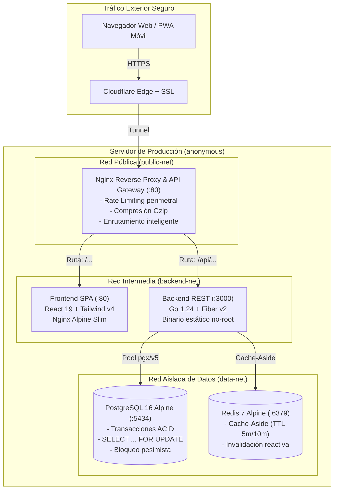

# MultiCatálogo — Plataforma Comercial Transaccional & Red Multinivel (MLM)

<div align="center">

[](https://github.com/angelcontres/multicatalogo/actions/workflows/ci.yml)
[](https://github.com/angelcontres/multicatalogo/actions/workflows/deploy.yml)


**Plataforma web de alta transaccionalidad para comercio electrónico cosmético con cálculo recursivo de comisiones multinivel (MLM), almacenamiento en caché reactiva y persistencia ACID pesimista.**

[🌐 Ver Aplicación en Producción](https://multicatalogo.tuxeros.website/) · [📖 Guía de Sustentación para Evaluación](GUIA_DEFENSA.md) · [📐 Especificación SRS / DRS](docs/LEVANTAMIENTO_REQUERIMIENTOS.md) · [🏛️ Diseño de Software (SDD)](docs/sdd/)

</div>

---

## 📌 Datos Académicos

- **Institución:** Universidad Estatal Península de Santa Elena (UPSE)
- **Facultad:** Facultad de Ciencias de la Ingeniería
- **Carrera:** Tecnologías de la Información
- **Asignatura:** Frameworks de Programación Web
- **Estudiante:** Angel Alejandro Villón Panimboza
- **Entorno de Producción:** Servidor propio (`anonymous`) orquestado vía GitHub Actions & Cloudflare Tunnel.

---

## 🏛️ Arquitectura del Sistema (C4 Containers / Zero-Trust)

El sistema opera bajo una arquitectura de micro-servicios desacoplados con segmentación estricta de red (*Zero-Trust*), donde el único punto de entrada exterior es un **API Gateway Nginx con Rate Limiting perimetral**:



---

## 🚀 Características y Cumplimiento del Sílabo

### 1. Unidad 1 — Frontend SPA Reactivo (React 19 + Tailwind CSS v4)
- **Storefront Full-Screen (`/tienda`):** Hero inmersivo con catálogo interactivo y categorías cosméticas.
- **Catálogo con Búsqueda Reactiva (`/catalogo`):** Filtros combinados por categoría y búsqueda en tiempo real optimizada con `useMemo`.
- **Insignia de Caché Redis en Vivo:** Detección de cabecera `X-Cache` que muestra en pantalla si la respuesta provino de RAM (`🟢 Redis: HIT < 5ms`) o de PostgreSQL (`🟡 Redis: MISS`).
- **Carrito & Límites de Usuario (`/carrito`):** Persistencia aislada en `localStorage` vinculada al email del usuario autenticado (`multicatalogo_carrito_<email>`).
- **PWA (Progressive Web App):** Instalable en Android, iOS y Escritorio. Service Worker con precaché de recursos estáticos e indicador visual de pérdida de conexión offline.

### 2. Unidad 2 — Backend Transaccional de Misión Crítica (Go + Fiber)
- **Transacciones ACID & Bloqueo Pesimista (`POST /api/checkout`):**
  - Utiliza `SELECT stock FROM productos WHERE id = $1 FOR UPDATE` para garantizar la integridad del stock y prevenir sobreventas (*overselling*).
  - Manejo atómico con `defer tx.Rollback(ctx)` y confirmación mediante `tx.Commit(ctx)`.
- **Concurrencia Desacoplada con Goroutines:**
  - El checkout no bloquea la pantalla de confirmación del cliente: tras el commit de la orden, despacha una **Goroutine asíncrona** (`go func()`) que calcula las comisiones ascendentes en segundo plano e invalida la caché de Redis.
- **Motor Multinivel MLM de 3 Niveles:**
  - **Nivel 1 (Patrocinador directo):** `10%` de comisión.
  - **Nivel 2 (Patrocinador secundario):** `5%` de comisión.
  - **Nivel 3 (Patrocinador terciario):** `2%` de comisión.
  - Más allá del nivel 3: `0%` inmutable.
- **Patrón Cache-Aside con Redis:**
  - `productos:all` (TTL 5 minutos).
  - `red:tree:{email}` (TTL 10 minutos).
  - Invalidación reactiva instantánea ante eventos de escritura (compras o modificaciones de inventario).
- **Simulación Didáctica de Rollback ACID:**
  - Casilla interactiva en el Checkout para forzar una caída a mitad de la transacción y demostrar ante el docente que la base de datos revierte los cambios sin crear pedidos fantasmas ni alterar el stock.

### 3. Back-Office Comercial & Ciclo de Vida de Pedidos
- **Consola de Catálogo (`/admin/productos`):** Alta interactiva de productos, edición de precio y stock en caliente, y borrado lógico.
- **Control de Pedidos (`/admin/pedidos`):** Transiciones de estado de despacho (`pendiente` ➔ `preparando` ➔ `enviado` ➔ `entregado`) y cancelación con devolución de stock y reversión (*clawback*) de comisiones.
- **Liquidaciones de Comisiones (`/admin/liquidaciones`):** Emisión y liquidación masiva de saldos a distribuidores con referencia bancaria.
- **Área de Cliente (`/mis-pedidos` y `/mi-red`):** Seguimiento en tiempo real de compras, enlace propio de patrocinador para copiar en 1 clic (`/registro?ref=CODIGO`) y ledger auditable de comisiones devengadas.

---

## 🔑 Credenciales de Prueba

| Perfil | Email | Contraseña | Vistas y Permisos |
|---|---|---|---|
| **👑 Administrador** | `admin@upse.edu.ec` | `123456` | Acceso total: Dashboard KPIs, Catálogo CRUD, Gestión de Pedidos y Liquidaciones MLM. |
| **🛍️ Cliente (Luis)** | `cliente@upse.edu.ec` | `123456` | Tienda, Catálogo, Carrito, Mis Pedidos, Red de Afiliados y Enlace de Referido. |
| **🌟 Líder MLM (Ana)** | `ana@upse.edu.ec` | `123456` | Red de distribuidores con comisiones acumuladas de segundo y tercer nivel. |

*(Nota: En la pantalla de Login `/login`, las credenciales son botones de 1 clic para autocompletar).*

---

## 🛠️ Ejecución y Despliegue Rápido

El repositorio incluye un **Centro de Control Interactivo** para Windows y Linux:

### En Windows (PowerShell / CMD):
```powershell
.\menu.bat
```

### En Linux / Mac (Bash):
```bash
chmod +x menu.sh
./menu.sh
```

El menú te permite:
1. **Entorno Local Ligero:** Levanta Frontend (`:5173`) y Backend (`:3000`) sin requerir Docker.
2. **Entorno Híbrido:** Backend y Frontend en local conectados a PostgreSQL y Redis en Docker.
3. **Pila de Producción Docker:** Compila y levanta la arquitectura completa (Gateway Nginx `:80`, Frontend `:80`, Backend `:3000`, Postgres `:5434`, Redis `:6379`).
4. **Diagnóstico Integral:** Ejecuta `python harness/ai_harness.py doctor`.
5. **Verificación Automatizada:** Ejecuta las suites de pruebas de negocio y contratos.

---

## 🧪 Pruebas Automatizadas (AI Harness)

El proyecto cuenta con un arnés de verificación automatizada:

```powershell
# 1. Comprobación de ESLint y TypeScript (0 errores, 0 advertencias)
npm --prefix multicatalogo-frontend run lint
npm --prefix multicatalogo-frontend run build

# 2. Verificación matemática de la regla de comisiones MLM (10% / 5% / 2%)
python harness/ai_harness.py test mlm

# 3. Validación de contratos canónicos de API y errores HTTP
python harness/ai_harness.py test contracts

# 4. Simulación transaccional ACID de concurrencia y rollback
python harness/ai_harness.py test acid-sim

# 5. Reporte consolidado de cumplimiento de requisitos (43/43 completados)
python harness/ai_harness.py status
```

---

## 📦 Colección de Endpoints API (Postman / HTTP)

Importa la colección oficial ubicada en [`docs/MultiCatálogo.postman_collection.json`](docs/MultiCatálogo.postman_collection.json) para probar todos los servicios:

| Método | Endpoint | Descripción | Requiere Autenticación |
|---|---|---|---|
| `GET` | `/api/health` | Estado del servidor y monitor de salud | No |
| `POST` | `/api/login` | Autenticación y entrega de JWT (HS256) | No |
| `POST` | `/api/register` | Registro de nuevos distribuidores con código patrocinador | No |
| `GET` | `/api/productos` | Catálogo de productos (Cache-Aside Redis TTL 5m) | No |
| `POST` | `/api/productos` | Alta de nuevo producto | Sí (Admin) |
| `PUT` | `/api/productos/:id` | Modificación de precio y stock | Sí (Admin) |
| `DELETE` | `/api/productos/:id` | Desactivación / borrado lógico de producto | Sí (Admin) |
| `GET` | `/api/red` | Árbol jerárquico multinivel (Cache-Aside Redis TTL 10m) | Opcional |
| `POST` | `/api/checkout` | Compra transaccional con bloqueo pesimista y Goroutines | Sí |
| `GET` | `/api/pedidos/mios` | Historial de compras del cliente actual | Sí |
| `GET` | `/api/pedidos` | Consola administrativa de pedidos | Sí (Admin) |
| `PATCH`| `/api/pedidos/:id/estado` | Transición del estado del pedido | Sí (Admin) |
| `POST` | `/api/pedidos/:id/cancelar` | Cancelación transaccional con restitución de inventario | Sí (Admin) |
| `GET` | `/api/comisiones/mias`| Ledger auditable de comisiones del distribuidor | Sí |
| `POST` | `/api/liquidaciones` | Emisión y pago de comisiones acumuladas | Sí (Admin) |

---

## 📄 Licencia

Desarrollado para fines académicos en la **Universidad Estatal Península de Santa Elena (UPSE)**.  
Distribuido bajo la Licencia MIT.
