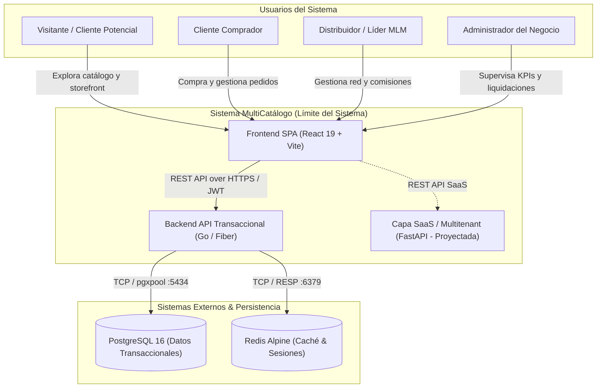
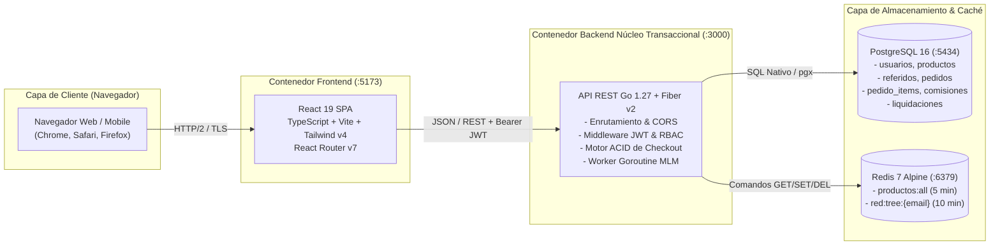

# SDD-01.1: MODELO C4 Y CONTENEDORES DEL SISTEMA

## 1. Diagrama de Contexto del Sistema (C4 - Nivel 1)

El sistema **MultiCatálogo** atiende a usuarios públicos, clientes registrados, distribuidores de la red multinivel y administradores del negocio, interactuando con pasarelas de notificación y servicios de base de datos.

---

## 2. Diagrama de Contenedores (C4 - Nivel 2)

Los contenedores representan aplicaciones ejecutables, almacenes de datos o microservicios que componen la solución:

---

## 3. Topología de Red y Convenciones de Puertos

| Servicio | Contenedor / Host | Puerto Interno | Puerto Host Mapeado | Justificación de Puerto |
|---|---|---|---|---|
| **Frontend Web** | Local Node.js / Vite | `5173` | `5173` | Puerto estándar de Vite, configurable en `vite.config.ts`. |
| **Backend API** | Binario Go nativo | `3000` | `3000` (o `3001` vía `PORT`) | Configurable por variable de entorno para evitar colisión con otros servicios. |
| **PostgreSQL 16** | Docker `multicatalogo-postgres` | `5432` | `5434` | **Puerto 5434 obligatorio** para evitar colisiones con instancias locales (`postgres.exe` en 5432 y contenedores en 5433). |
| **Redis 7 Alpine** | Docker `multicatalogo-redis` | `6379` | `6379` | Puerto estándar Redis. |
