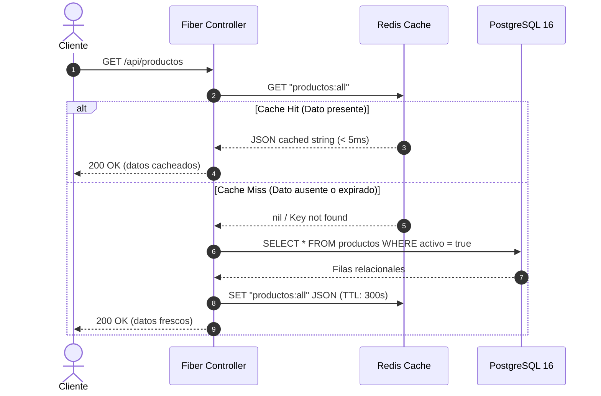

# SDD-01.2: PATRONES ARQUITECTÓNICOS Y DE DISEÑO

## 1. Patrón Arquitectónico en Capas (Layered Architecture)

El backend en Go adopta una arquitectura en capas unidireccional con separación estricta de responsabilidades:

```
[ Petición HTTP ]
        │
        ▼
[ Capa de Rutas (routes/routes.go) ]
        │ Registra endpoints y asocia middlewares de seguridad
        ▼
[ Capa de Controladores (controllers/*.go) ]
        │ Valida DTOs, extrae identidad de c.Locals, maneja respuestas HTTP
        ▼
[ Capa de Dominio & Lógica Pura (domain/*.go) ]
        │ Funciones puras (RepartirComisiones, cálculo de subtotales)
        ▼
[ Capa de Repositorio & Persistencia (repository/*.go) ]
        │ SQL nativo con transacciones ACID (pgx) y operaciones de caché (go-redis)
        ▼
[ Capa de Infraestructura & Drivers (config/db.go, config/redis.go) ]
        │ Pools de conexiones a PostgreSQL y Redis
        ▼
[ Base de Datos / Redis ]
```

---

## 2. Inversión de Dependencias (Dependency Inversion Principle - DIP)

Para evitar el acoplamiento rígido con drivers específicos y facilitar pruebas unitarias automatizadas sin I/O, los controladores no conocen la implementación concreta de la base de datos o la caché:

```go
// Definición de interfaces en repository/
type DBRepository interface {
    BuscarUsuarioPorCredenciales(ctx context.Context, email, password string) (*models.Usuario, error)
    ObtenerProductos(ctx context.Context) ([]models.Producto, error)
    ObtenerProductoPorID(ctx context.Context, id int) (*models.Producto, error)
    CrearPedido(ctx context.Context, req *models.CheckoutRequest, usuarioID int) (*models.Pedido, error)
    CalcularComisiones(ctx context.Context, total float64, usuarioID int) error
    ObtenerRed(ctx context.Context, email string) ([]models.Referido, error)
}

type CacheRepository interface {
    Get(ctx context.Context, key string) (string, error)
    Set(ctx context.Context, key string, value interface{}, ttl time.Duration) error
    Del(ctx context.Context, keys ...string) error
}

// Inyección en controladores
type CheckoutController struct {
    repo  DBRepository
    cache CacheRepository
}

func NewCheckoutController(repo DBRepository, cache CacheRepository) *CheckoutController {
    return &CheckoutController{repo: repo, cache: cache}
}
```

---

## 3. Patrón Cache-Aside (Lazy Loading con Invalidación Reactiva)

Las consultas de lectura intensa (`GET /api/productos` y `GET /api/red`) delegan en Redis para evitar la sobrecarga del motor relacional:



---

## 4. Patrón de Concurrencia Desacoplada (Background Worker Goroutines)

Para preservar la baja latencia percibida por el comprador durante el checkout, las tareas analíticas y de reparto MLM ascendente no bloquean la respuesta HTTP:

1. El request ejecuta la transacción ACID y hace `COMMIT`.
2. El controller envía inmediatamente la respuesta HTTP `201 Created` al cliente con el ID del pedido.
3. Se dispara una goroutine independiente:
   ```go
   go func(total float64, usuarioID int) {
       // Contexto desacoplado con timeout de seguridad (no hereda el ctx de Fiber)
       ctx, cancel := context.WithTimeout(context.Background(), 10*time.Second)
       defer cancel()
       _ = repo.CalcularComisiones(ctx, total, usuarioID)
       _ = cache.Del(ctx, "productos:all")
   }(pedido.Total, usuario.ID)
   ```
