# SDD-02.1: DISEÑO FRONTEND — COMPONENTES Y LAYOUT

## 1. Arquitectura de Componentes (React 19 + TypeScript)

El frontend está estructurado bajo una jerarquía modular basada en Atomic Design adaptado para SPA:

```
src/
├── components/          # Vistas completas y componentes de interfaz
│   ├── Layout.tsx       # Shell maestro responsive (Navbar + Sidebar + Main Outlet)
│   ├── Navbar.tsx       # Barra superior con carrito reactivo, badge y avatar
│   ├── Sidebar.tsx      # Menú de navegación colapsable y adaptativo a móviles
│   ├── Storefront.tsx   # Vista /tienda: Hero full-screen, grid cosmético y banner MLM
│   ├── Catalogo.tsx     # Vista /catalogo: Búsqueda reactiva, filtros de categoría y tarjetas
│   ├── DetalleProducto.tsx # Vista /producto/:id: Imagen ampliada, especificaciones, selector
│   ├── Carrito.tsx      # Vista /carrito: Listado de ítems, cálculo en vivo y navegación
│   ├── Checkout.tsx     # Vista /checkout: Formulario transaccional y validación mobile-first
│   ├── Confirmacion.tsx # Vista /confirmacion: Resumen de compra e ID de orden
│   ├── MiRed.tsx        # Vista /mi-red: Árbol interactivo de referidos y comisiones
│   ├── Dashboard.tsx    # Vista /: Dashboard administrativo con KPIs y métricas
│   └── Login.tsx        # Vista /login: Acceso con credenciales y redirección por rol
├── context/             # Proveedores de estado global (Context API)
│   ├── AuthContext.tsx  # Sesión de usuario, token JWT y rol (admin / cliente)
│   └── CartContext.tsx  # Carrito persistente en localStorage por usuario
├── services/            # Capa desacoplada de consumo HTTP
│   ├── http.ts          # Cliente centralizado apiFetch con inyección de JWT
│   ├── productosService.ts # Métodos GET/POST/PUT/DELETE de catálogo
│   └── redService.ts    # Métodos de red multinivel y comisiones
└── data/                # Tipos TypeScript y funciones puras de dominio
    ├── productos.ts     # Interface Producto, Categorías fijas
    └── red.ts           # Interface Referido, cálculo puro de comisiones
```

---

## 2. Enrutamiento y Guardas de Seguridad (React Router v7)

El archivo `src/App.tsx` organiza las rutas en tres niveles:
1. **Rutas Públicas:** Accesibles para cualquier visitante sin token.
2. **Rutas Protegidas (`ProtectedRoute`):** Exigen sesión activa (`isAuthenticated === true`). Si no hay sesión, redirige a `/login`.
3. **Rutas Administrativas (`AdminRoute`):** Exigen `rol === 'admin'`. Si un cliente intenta ingresar, se le deniega el acceso o se redirige al catálogo.

```mermaid
flowchart TD
    Req["Petición de Navegación"] --> GuardAuth{"¿Tiene JWT válido?"}
    GuardAuth -- No --> RedirectLogin["Redirigir a /login"]
    GuardAuth -- Sí --> GuardAdmin{"¿Ruta requiere Admin?"}
    GuardAdmin -- Sí --> CheckRol{"¿Rol === 'admin'?"}
    CheckRol -- No --> RedirectCat["Redirigir a /catalogo (403 UI)"]
    CheckRol -- Sí --> RenderAdmin["Renderizar Dashboard / Admin"]
    GuardAdmin -- No --> RenderClient["Renderizar Vista de Cliente"]
```



---

## 3. Pautas de Diseño Mobile-First y Accesibilidad

1. **Resolución Mínima de Soporte:** 360px de ancho de viewport sin scroll horizontal forzado.
2. **Dimensiones de Botones Táctiles:** Mínimo de 44x44 píxeles para todos los elementos interactivos (`Añadir al Carrito`, botones de cantidad `+` y `-`, botón de cierre de sesión).
3. **Lightbox Accesible:**
   - Cierre interactivo mediante teclado al presionar la tecla `Escape`.
   - Trampa de foco (`focus trap`) para evitar que el lector de pantalla navegue fuera del modal cuando está activo.
4. **Tailwind CSS v4 CSS-First:**
   - Sin archivos obsoletos `tailwind.config.js` o `postcss.config.js`.
   - Directiva única `@import "tailwindcss";` en `src/index.css`.
