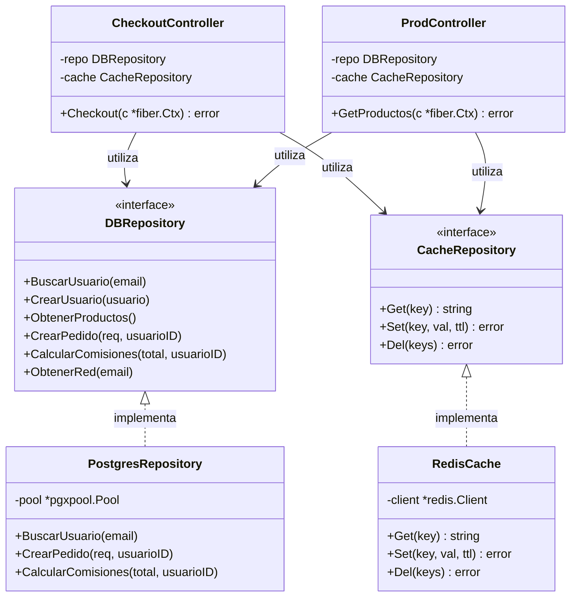

# SDD-03.1: DISEÑO BACKEND — CAPAS E INYECCIÓN DE DEPENDENCIAS

## 1. Estructura de Paquetes en Go (`multicatalogo-backend/`)

La aplicación Go 1.27 está organizada en módulos autocontenidos:

```
multicatalogo-backend/
├── main.go               # Entry point: conexión de infra, ensamblado de DI y arranque
├── go.mod / go.sum       # Definición de dependencias (Fiber v2, pgx v5, go-redis v9)
├── config/               # Inicialización de clientes externos
│   ├── db.go             # Pool pgx hacia PostgreSQL 16 (:5434)
│   └── redis.go          # Cliente go-redis (:6379)
├── models/               # Structs de DTOs, entidades y contrato APIError
│   └── models.go
├── routes/               # Enrutamiento de endpoints
│   └── routes.go         # SetupRoutes(app *fiber.App, c *controllers.Controllers)
├── controllers/          # Manejadores HTTP
│   ├── controllers.go    # Agregador contenedor de controladores
│   ├── authController.go # POST /api/login, POST /api/register
│   ├── prodController.go # GET /api/productos, CRUD admin
│   ├── checkoutController.go # POST /api/checkout transaccional
│   ├── redController.go  # GET /api/red/mia, comisiones
│   ├── pedidoController.go # Historial y cambio de estados
│   └── healthController.go # GET /api/health con ping a DB y Redis
├── repository/           # Capa de acceso a datos
│   ├── repository.go     # Interfaces DBRepository y CacheRepository
│   ├── postgres.go       # Implementación PostgreSQL con pgx
│   └── cache.go          # Implementación Redis con go-redis
└── middleware/           # Interceptores de seguridad
    └── auth.go           # RequireAuth, RequireAdmin
```

---

## 2. Diagrama de Inyección de Dependencias (DI)



---

## 3. Ensamblado en `main.go`

El archivo `main.go` es el único lugar donde se instancian las implementaciones concretas:

```go
func main() {
    // 1. Conexiones
    dbPool := config.ConnectDB()
    defer dbPool.Close()

    redisClient := config.ConnectRedis()
    defer redisClient.Close()

    // 2. Repositorios concretos
    dbRepo := repository.NewPostgresRepository(dbPool)
    cacheRepo := repository.NewRedisCache(redisClient)

    // 3. Controladores
    ctrls := controllers.NewControllers(dbRepo, cacheRepo)

    // 4. Instancia Fiber
    app := fiber.New()
    routes.SetupRoutes(app, ctrls)

    port := os.Getenv("PORT")
    if port == "" {
        port = "3000"
    }
    app.Listen(":" + port)
}
```
