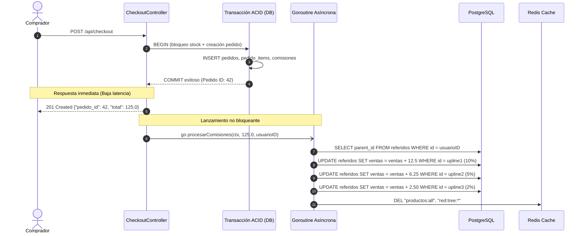

# SDD-03.2: DISEÑO BACKEND — CONCURRENCIA Y GOROUTINES

## 1. Patrón de Desacoplamiento Concurrente para Comisiones MLM

El cálculo de comisiones multinivel involucra recorrer la jerarquía de patrocinadores ascendentes (*upline*) hasta 3 niveles y actualizar sus contadores estadísticos en base de datos. Si este proceso se ejecutara de forma síncrona dentro del ciclo de vida de la petición HTTP de checkout, la latencia para el comprador aumentaría innecesariamente.



---

## 2. Gestión Segura de Contextos (`context.Context`)

### Riesgo de Cancelación Prematura
En Fiber, cuando una petición HTTP finaliza, el contexto del request (`c.Context()`) es cancelado inmediatamente por el servidor. Si una Goroutine usara ese mismo contexto, el cálculo de comisiones sería abortado a mitad de camino (`context canceled`).

### Solución Arquitectónica
La goroutine crea un contexto desacoplado e independiente con un timeout preventivo:

```go
func (cc *CheckoutController) PostCheckout(c *fiber.Ctx) error {
    // 1. Ejecutar transacción ACID de compra
    pedido, err := cc.repo.CrearPedido(c.Context(), req, usuarioID)
    if err != nil {
        return handleRepoError(c, err)
    }

    // 2. Disparar cálculo asíncrono en background con contexto propio
    go func(total float64, uid int) {
        // Contexto independiente con timeout de 10 segundos
        bgCtx, cancel := context.WithTimeout(context.Background(), 10*time.Second)
        defer cancel()

        if err := cc.repo.CalcularComisiones(bgCtx, total, uid); err != nil {
            log.Printf("[ERROR] Falla al procesar comisiones asíncronas para usuario %d: %v", uid, err)
        }

        // Invalidar caché tras impacto en red
        _ = cc.cache.Del(bgCtx, "productos:all")
    }(pedido.Total, usuarioID)

    // 3. Responder de inmediato al cliente
    return c.Status(201).JSON(fiber.Map{
        "pedido_id": pedido.ID,
        "total":     pedido.Total,
        "message":   "Pedido creado y procesado exitosamente",
    })
}
```
