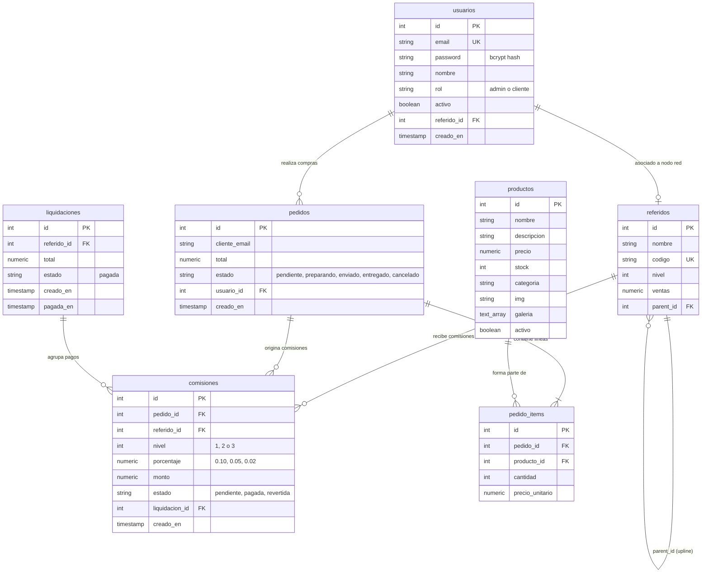

# SDD-04.1: PERSISTENCIA Y DATOS — MODELO RELACIONAL Y DDL

## 1. Diagrama Entidad-Relación (ERD)



---

## 2. Definición del Esquema SQL (DDL PostgreSQL 16)

```sql
-- Extensión pgcrypto para hashing y funciones criptográficas
CREATE EXTENSION IF NOT EXISTS pgcrypto;

-- 1. Tabla de Usuarios
CREATE TABLE IF NOT EXISTS usuarios (
    id SERIAL PRIMARY KEY,
    email VARCHAR(150) UNIQUE NOT NULL,
    password VARCHAR(255) NOT NULL,
    nombre VARCHAR(150) NOT NULL DEFAULT '',
    rol VARCHAR(50) NOT NULL DEFAULT 'cliente',
    activo BOOLEAN NOT NULL DEFAULT true,
    referido_id INTEGER,
    creado_en TIMESTAMP WITH TIME ZONE DEFAULT NOW()
);

-- 2. Tabla de Árbol Multinivel (Referidos)
CREATE TABLE IF NOT EXISTS referidos (
    id SERIAL PRIMARY KEY,
    nombre VARCHAR(150) NOT NULL,
    codigo VARCHAR(50) UNIQUE NOT NULL,
    nivel INTEGER NOT NULL DEFAULT 1,
    ventas NUMERIC(12, 2) NOT NULL DEFAULT 0.00,
    parent_id INTEGER REFERENCES referidos(id) ON DELETE SET NULL
);

-- Foreign Key cruzada usuarios -> referidos
ALTER TABLE usuarios 
    ADD CONSTRAINT fk_usuario_referido 
    FOREIGN KEY (referido_id) REFERENCES referidos(id) ON DELETE SET NULL;

-- 3. Tabla de Productos (Catálogo)
CREATE TABLE IF NOT EXISTS productos (
    id SERIAL PRIMARY KEY,
    nombre VARCHAR(150) NOT NULL,
    descripcion TEXT,
    precio NUMERIC(10, 2) NOT NULL,
    stock INTEGER NOT NULL DEFAULT 0,
    categoria VARCHAR(100) NOT NULL,
    img TEXT NOT NULL,
    galeria TEXT[] DEFAULT '{}',
    activo BOOLEAN NOT NULL DEFAULT true
);

-- 4. Tabla de Pedidos
CREATE TABLE IF NOT EXISTS pedidos (
    id SERIAL PRIMARY KEY,
    cliente_email VARCHAR(150) NOT NULL,
    total NUMERIC(12, 2) NOT NULL,
    estado VARCHAR(50) NOT NULL DEFAULT 'pendiente',
    usuario_id INTEGER REFERENCES usuarios(id),
    creado_en TIMESTAMP WITH TIME ZONE DEFAULT NOW()
);

-- 5. Detalle de Ítems del Pedido
CREATE TABLE IF NOT EXISTS pedido_items (
    id SERIAL PRIMARY KEY,
    pedido_id INTEGER NOT NULL REFERENCES pedidos(id) ON DELETE CASCADE,
    producto_id INTEGER NOT NULL REFERENCES productos(id),
    cantidad INTEGER NOT NULL,
    precio_unitario NUMERIC(10, 2) NOT NULL
);

-- 6. Liquidaciones a Distribuidores
CREATE TABLE IF NOT EXISTS liquidaciones (
    id SERIAL PRIMARY KEY,
    referido_id INTEGER NOT NULL REFERENCES referidos(id),
    total NUMERIC(12, 2) NOT NULL,
    estado VARCHAR(50) NOT NULL DEFAULT 'pagada',
    creado_en TIMESTAMP WITH TIME ZONE DEFAULT NOW(),
    pagada_en TIMESTAMP WITH TIME ZONE DEFAULT NOW()
);

-- 7. Ledger Inmutable de Comisiones
CREATE TABLE IF NOT EXISTS comisiones (
    id SERIAL PRIMARY KEY,
    pedido_id INTEGER NOT NULL REFERENCES pedidos(id) ON DELETE CASCADE,
    referido_id INTEGER NOT NULL REFERENCES referidos(id),
    nivel INTEGER NOT NULL CHECK (nivel IN (1, 2, 3)),
    porcentaje NUMERIC(5, 2) NOT NULL,
    monto NUMERIC(10, 2) NOT NULL,
    estado VARCHAR(50) NOT NULL DEFAULT 'pendiente' CHECK (estado IN ('pendiente', 'pagada', 'revertida')),
    liquidacion_id INTEGER REFERENCES liquidaciones(id),
    creado_en TIMESTAMP WITH TIME ZONE DEFAULT NOW()
);

-- Índices de Rendimiento para Consultas Rápidas
CREATE INDEX IF NOT EXISTS idx_referidos_parent_id ON referidos(parent_id);
CREATE INDEX IF NOT EXISTS idx_pedidos_usuario_id ON pedidos(usuario_id);
CREATE INDEX IF NOT EXISTS idx_pedidos_cliente_email ON pedidos(cliente_email);
CREATE INDEX IF NOT EXISTS idx_pedido_items_pedido_id ON pedido_items(pedido_id);
CREATE INDEX IF NOT EXISTS idx_comisiones_referido_id ON comisiones(referido_id);
CREATE INDEX IF NOT EXISTS idx_productos_categoria ON productos(categoria);
CREATE INDEX IF NOT EXISTS idx_productos_activo ON productos(activo);
```
