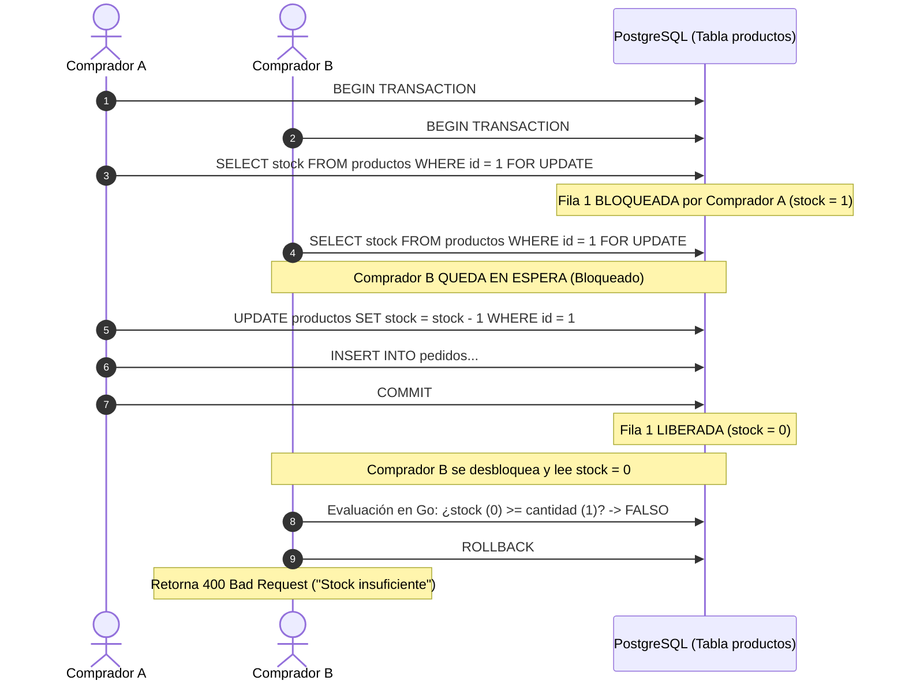

# SDD-04.2: PERSISTENCIA Y DATOS — TRANSACCIONES ACID Y BLOQUEOS

## 1. Garantías ACID en el Núcleo Transaccional

El proceso de compra en `POST /api/checkout` exige cumplimiento estricto de las propiedades ACID:

- **Atomicidad:** Si falla la comprobación de stock de cualquiera de los 5 artículos del carrito, o si ocurre una falla en red antes de insertar el último ítem, se ejecuta `ROLLBACK` y la base de datos queda exactamente como antes del intento.
- **Consistencia:** Las claves foráneas hacia `productos` y `usuarios`, y las restricciones `CHECK` en `comisiones(nivel IN (1, 2, 3))` aseguran que no existan registros huérfanos o inválidos.
- **Aislamiento:** El aislamiento se garantiza mediante bloqueo de filas pesimista a nivel de fila (`SELECT ... FOR UPDATE`), impidiendo que dos compradores simultáneos sobregiren el stock.
- **Durabilidad:** Una vez recibido el `COMMIT`, los datos residen en el volumen WAL persistente de PostgreSQL (`pgdata`), sobreviviendo a caídas del contenedor.

---

## 2. Estrategia de Bloqueo Pesimista (`FOR UPDATE`)

Para evitar condiciones de carrera (*Race Conditions*) o sobreventas (*overselling*) cuando dos usuarios intentan comprar la última unidad al mismo milisegundo:



---

## 3. Implementación Go con `pgx.Tx`

```go
func (r *PostgresRepository) CrearPedido(ctx context.Context, req *models.CheckoutRequest, usuarioID int) (*models.Pedido, error) {
    tx, err := r.pool.Begin(ctx)
    if err != nil {
        return nil, fmt.Errorf("error al iniciar transaccion: %w", err)
    }
    // Salvaguarda: si no se hace Commit explícito, ejecuta Rollback seguro
    defer tx.Rollback(ctx)

    var totalCalculado float64 = 0.0

    // 1. Validar y bloquear stock para cada producto
    for _, item := range req.Items {
        var stockActual int
        var precioUnitario float64

        // Bloqueo pesimista
        err := tx.QueryRow(ctx, "SELECT stock, precio FROM productos WHERE id = $1 FOR UPDATE", item.ProductoID).
            Scan(&stockActual, &precioUnitario)
        if err != nil {
            return nil, fmt.Errorf("producto %d no encontrado", item.ProductoID)
        }

        if stockActual < item.Cantidad {
            return nil, fmt.Errorf("stock insuficiente para producto %d (disponible: %d, solicitado: %d)", 
                item.ProductoID, stockActual, item.Cantidad)
        }

        // Descontar inventario
        _, err = tx.Exec(ctx, "UPDATE productos SET stock = stock - $1 WHERE id = $2", item.Cantidad, item.ProductoID)
        if err != nil {
            return nil, fmt.Errorf("falla al actualizar stock: %w", err)
        }

        totalCalculado += precioUnitario * float64(item.Cantidad)
    }

    // 2. Insertar cabecera del pedido (recalculando total)
    var pedidoID int
    err = tx.QueryRow(ctx, 
        "INSERT INTO pedidos (cliente_email, total, estado, usuario_id) VALUES ($1, $2, 'pendiente', $3) RETURNING id",
        req.Email, totalCalculado, usuarioID).Scan(&pedidoID)
    if err != nil {
        return nil, fmt.Errorf("falla al insertar pedido: %w", err)
    }

    // 3. Insertar items y registrar ledger de comisiones
    for _, item := range req.Items {
        var precioUnitario float64
        _ = tx.QueryRow(ctx, "SELECT precio FROM productos WHERE id = $1", item.ProductoID).Scan(&precioUnitario)
        _, err = tx.Exec(ctx, 
            "INSERT INTO pedido_items (pedido_id, producto_id, cantidad, precio_unitario) VALUES ($1, $2, $3, $4)",
            pedidoID, item.ProductoID, item.Cantidad, precioUnitario)
        if err != nil {
            return nil, fmt.Errorf("falla al insertar pedido_items: %w", err)
        }
    }

    // 4. Confirmación atómica
    if err := tx.Commit(ctx); err != nil {
        return nil, fmt.Errorf("error al hacer commit del pedido: %w", err)
    }

    return &models.Pedido{ID: pedidoID, Total: totalCalculado}, nil
}
```
