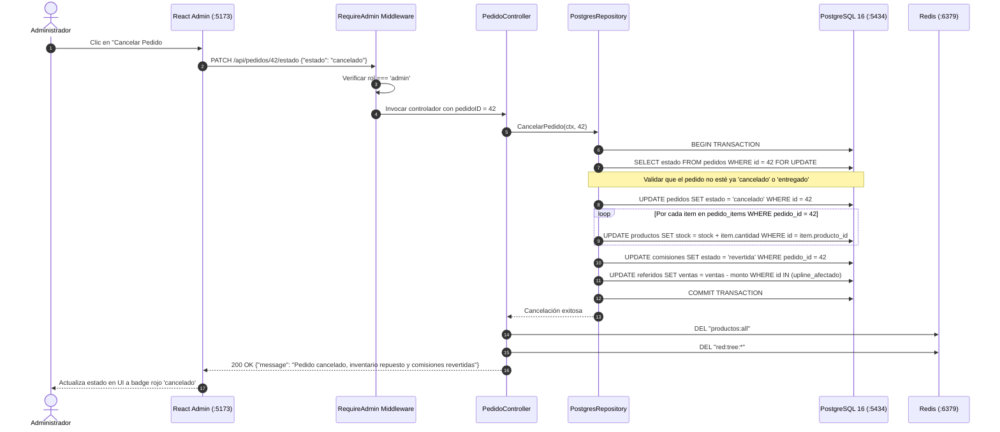

# SDD-07.2: FLUJOS Y SECUENCIAS — CANCELACIÓN Y REVERSIÓN (CLAWBACK)

## 1. Principio de Transacción Espejo (Clawback)

En un negocio multinivel, si un pedido es cancelado o devuelto por el comprador, el sistema no puede limitarse a cambiar un flag en la cabecera del pedido. Hacerlo sin una transacción de reversión completa causaría dos inconsistencias graves:
1. **Pérdida de Inventario:** El stock físico volvería a bodega pero no en la base de datos.
2. **Fraude en Comisiones:** Los distribuidores cobrarían comisiones por ventas que nunca se concretaron.

---

## 2. Diagrama de Secuencia de Cancelación

