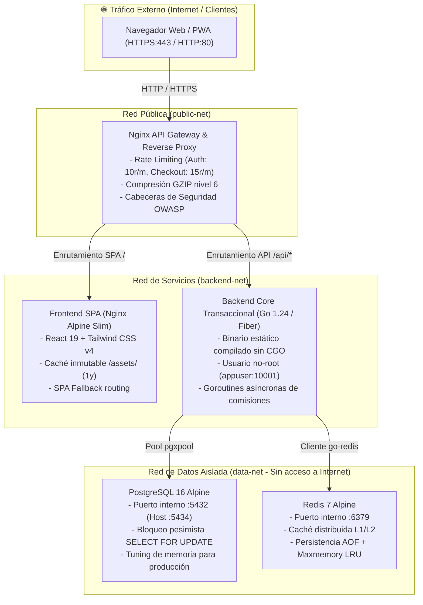

# SDD 08 — ARQUITECTURA DE CONTENERIZACIÓN Y DESPLIEGUE EN PRODUCCIÓN

> **Módulo:** Infraestructura, Docker y Despliegue de Alta Disponibilidad  
> **Requerimientos Asociados:** REQ-NF-01, REQ-NF-02, REQ-NF-04, REQ-SEG-01  
> **Estado:** Implementado / Producción Ultra-Optimizada

---

## 1. VISIÓN GENERAL DE LA TOPOLOGÍA DE PRODUCCIÓN

La arquitectura de despliegue en producción de **MultiCatálogo** está fundamentada en un modelo de micro-servicios contenerizados mediante **Docker** y orquestados a través de **Docker Compose** con aislamiento de red de tres niveles (**Zero-Trust Network Segmentation**).

El tráfico entrante de clientes web y móviles entra exclusivamente a través de un **API Gateway & Reverse Proxy Nginx**, el cual gestiona la terminación TLS/SSL, el enrutamiento inteligente entre la SPA de React y la API de Go, compresión HTTP en tiempo real y protección perimetral mediante **Rate Limiting**.



---

## 2. ESTRATEGIA MULTI-STAGE BUILDS

Para garantizar contenedores con una superficie de ataque mínima, tiempos de arranque inferiores a 2 segundos y tamaños de imagen hiperligeros (~20MB para Go, ~25MB para React/Nginx), ambas aplicaciones utilizan compilación multietapa (**Multi-Stage Builds**).

### 2.1 Backend (`multicatalogo-backend/Dockerfile`)
1. **Etapa `builder` (`golang:1.24-alpine`):**
   - Descarga y verificación criptográfica de dependencias mediante `go.mod` y `go.sum` (aprovechamiento óptimo de la caché de capas Docker).
   - Compilación estática con desactivación estricta de CGO:
     ```bash
     CGO_ENABLED=0 GOOS=linux GOARCH=amd64 go build \
       -trimpath \
       -ldflags="-s -w -extldflags '-static'" \
       -o /bin/multicatalogo-backend .
     ```
2. **Etapa `runner` (`alpine:3.21` hardened):**
   - Instalación exclusiva de certificados raíz (`ca-certificates`), zona horaria (`tzdata`) y `wget` para sondas de salud.
   - Creación de usuario y grupo de sistema sin privilegios de superusuario (`appuser` con UID/GID `10001`).
   - Copia del binario compilado con propiedad de `appuser`.
   - Ejecución bajo el principio de menor privilegio (`USER appuser:appgroup`).
   - Sonda de salud integrada: `HEALTHCHECK --interval=10s --timeout=3s CMD wget -qO- http://127.0.0.1:3000/api/health > /dev/null || exit 1`.

### 2.2 Frontend (`multicatalogo-frontend/Dockerfile`)
1. **Etapa `builder` (`node:22-alpine`):**
   - Instalación limpia y reproducible con `npm ci --prefer-offline --no-audit`.
   - Compilación de TypeScript y Vite con tree-shaking, minificación y generación de chunks con nombres basados en hash criptográfico.
2. **Etapa `runner` (`nginx:1.27-alpine-slim`):**
   - Eliminación de plantillas predeterminadas de Nginx.
   - Inyección de `nginx.conf` optimizado con compresión GZIP de 9 tipos MIME, caché inmutable de 1 año para activos estáticos (`/assets/`) y directivas `no-cache` para `index.html`.
   - Sonda de salud integrada en `/healthz`.

---

## 3. ARQUITECTURA DEL REVERSE PROXY GATEWAY (`docker/nginx/`)

El API Gateway actúa como el guardián perimetral del sistema, proveyendo:

### 3.1 Rate Limiting por IP (`limit_req_zone`)
Para mitigar denegaciones de servicio (DDoS) y ataques de fuerza bruta contra credenciales o manipulación transaccional:
- **Autenticación y Registro (`/api/login`, `/api/register`):** 10 solicitudes por minuto con ráfaga (`burst=5`).
- **Checkout Transaccional (`/api/checkout`):** 15 solicitudes por minuto con ráfaga (`burst=5`).
- **Catálogo y Red General (`/api/`):** 30 solicitudes por segundo con ráfaga (`burst=20`).

### 3.2 Upstreams con Conexiones Persistentes (`keepalive`)
El gateway mantiene un pool de conexiones persistentes HTTP/1.1 hacia los contenedores de frontend y backend (`keepalive 32`), reduciendo drásticamente la latencia de apertura de sockets TCP en picos de alta demanda.

### 3.3 Cabeceras de Seguridad OWASP
Inyección automática de directivas defensivas en cada respuesta:
- `X-Frame-Options: SAMEORIGIN` (prevención de Clickjacking).
- `X-Content-Type-Options: nosniff` (prevención de MIME-sniffing).
- `X-XSS-Protection: 1; mode=block` (filtro defensivo en navegadores legados).
- `Referrer-Policy: strict-origin-when-cross-origin`.

---

## 4. AISLAMIENTO ZERO-TRUST Y CONEXIÓN DE DATOS

| Red Docker | Propósito | Servicios Conectados | Exposición al Host |
|---|---|---|---|
| `public-net` | Tráfico entrante de internet | `gateway` | Puertos `80` (HTTP) y `443` (HTTPS) |
| `backend-net` | Tráfico interno de servicios | `gateway`, `frontend`, `backend` | Ninguna |
| `data-net` | Datos transaccionales y caché | `backend`, `postgres`, `redis` | Puerto `5434` (PostgreSQL) y `6379` (Redis) para administración local |

> [!IMPORTANT]
> El frontend y el público no tienen ruta de red hacia `data-net`. Incluso si un atacante comprometiera el servidor web de la SPA, no puede alcanzar los puertos de PostgreSQL ni de Redis directamente.

---

## 5. POLÍTICA DE RESILENCIA, RECURSOS Y LOGGING

### 5.1 Límites de Recursos por Servicio
Para evitar colapsos por consumo desmedido de memoria (OOM Killer) o saturación de CPU:

| Servicio | Límite CPU | Reserva CPU | Límite RAM | Reserva RAM |
|---|---|---|---|---|
| `gateway` | `0.50` | `0.10` | `128 MB` | `32 MB` |
| `frontend` | `0.50` | `0.10` | `128 MB` | `32 MB` |
| `backend` | `1.00` | `0.20` | `256 MB` | `64 MB` |
| `postgres` | `1.00` | `0.25` | `512 MB` | `128 MB` |
| `redis` | `0.50` | `0.10` | `128 MB` | `32 MB` |

### 5.2 Rotación Automática de Logs
Todos los contenedores están configurados con el driver `json-file` y rotación estricta:
```yaml
logging:
  driver: "json-file"
  options:
    max-size: "10m"
    max-file: "3"
```
Esto garantiza que los registros nunca excederán 30 MB por contenedor, evitando que el disco del servidor se llene en producción.

---

## 6. COMANDOS DE OPERACIÓN Y DESPLIEGUE

### 6.1 Despliegue en Windows (PowerShell)
```powershell
# Despliegue completo con compilación de imágenes y verificación de salud
.\scripts\prod-deploy.ps1 -Build

# Monitoreo de logs en vivo
.\scripts\prod-deploy.ps1 -Logs

# Detención y desmontaje ordenado
.\scripts\prod-deploy.ps1 -Down
```

### 6.2 Despliegue en Linux / macOS (Bash)
```bash
chmod +x ./scripts/prod-deploy.sh

# Despliegue completo
./scripts/prod-deploy.sh --build

# Monitoreo de logs
./scripts/prod-deploy.sh --logs

# Detención
./scripts/prod-deploy.sh --down
```
